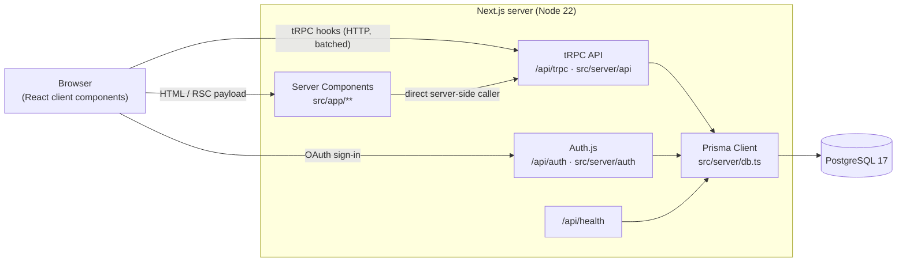

# dovivo

Real-estate web app to **buy**, **rent** and **publish** homes.

Built with the [T3 Stack](https://create.t3.gg/) (bootstrapped with `create-t3-app`). Development works on **Linux (Fedora)**, **macOS** and **Windows**.

---

## Table of contents

- [Tech stack](#tech-stack)
- [Architecture](#architecture)
- [Documentation](#documentation)
- [Project structure](#project-structure)
- [Prerequisites](#prerequisites) (per OS)
- [Getting started](#getting-started)
- [Running everything with Docker](#running-everything-with-docker)
- [Scripts](#scripts)
- [Database workflow](#database-workflow)
- [Environment variables](#environment-variables)
- [Team workflow & AI agents](#team-workflow--ai-agents)
- [Troubleshooting](#troubleshooting)

---

## Tech stack

| Layer      | Technology                                                      |
| ---------- | --------------------------------------------------------------- |
| Framework  | [Next.js 15](https://nextjs.org) (App Router, React 19, RSC)    |
| Language   | TypeScript (strict)                                             |
| API        | [tRPC 11](https://trpc.io) + [zod](https://zod.dev) validation  |
| Data       | [Prisma 6](https://prisma.io) ORM + PostgreSQL 17               |
| Auth       | [Auth.js / NextAuth v5](https://authjs.dev) (Prisma adapter)    |
| Styling    | [Tailwind CSS 4](https://tailwindcss.com)                       |
| Testing    | [Vitest](https://vitest.dev) (E2E with Playwright planned)      |
| Tooling    | pnpm, ESLint, Prettier, Docker / Docker Compose, GitHub Actions |

## Architecture

dovivo is a single **full-stack Next.js app** (a "modular monolith"). The frontend and the backend
live in the same repo and deploy together, and they share TypeScript types end to end with no code generation.



**Request flow**

1. **Server Components** (`src/app/**/page.tsx`) render pages on the server. They call tRPC
   procedures directly through `~/trpc/server` without an HTTP round-trip.
2. **Client Components** (`"use client"`) call the same procedures over HTTP with the typed React
   Query hooks in `~/trpc/react`.
3. **tRPC routers** (`src/server/api/routers`) validate inputs with zod (`src/lib/validators`),
   check auth (`publicProcedure` / `protectedProcedure`) and use **Prisma** to talk to Postgres.
4. **Auth.js** stores users, accounts and sessions in the same database through the Prisma adapter.

**Domain model** (`prisma/schema.prisma`)

```
User 1─* Property 1─* PropertyImage
  │          │
  └─* Favourite *─┘
```

- `Property`: `listingType` (`SALE` | `RENT`), `propertyType` (apartment, house, room...), `status`
  (`DRAFT` → `PUBLISHED` → `RESERVED` → `CLOSED`), price in **cents**, location and features.
- `User.role`: `USER` | `AGENT` | `ADMIN`.

**Deployment shape (Docker)**: `db` (Postgres) → `migrate` (one-shot `prisma migrate deploy`) →
`app` (Next.js standalone server, non-root, healthcheck on `/api/health`).

## Documentation

Design docs (index in [`docs/`](./docs/README.md)):

- [Backend contract](./dovivo_backend_contract.pdf) (Catalan): **source of truth** for the
  data model, the tRPC procedures per sprint and the T-07/T-09 spikes.
- [API usage notes](./docs/api.md): how to call the tRPC API, error codes and auth flows.
- [Architecture Decision Records](./docs/adr/): architecture (0001), authentication (0002),
  chat and chatbot (0003).

## Project structure

```
.
├── .claude/                 # Claude Code config: role agents (backend/frontend/devops/qa) + settings
├── .github/workflows/ci.yml # CI: lint, typecheck, test, build on Linux/Windows/macOS + Docker build
├── prisma/
│   ├── schema.prisma        # Data model (source of truth)
│   └── migrations/          # SQL migrations (committed)
├── public/                  # Static assets
├── src/
│   ├── app/                 # Next.js App Router
│   │   ├── _components/     # Shared UI (header, property card/list...)
│   │   ├── api/             # Route handlers: auth, trpc, health
│   │   ├── buy/  rent/      # Listings search pages
│   │   ├── properties/[id]/ # Property detail
│   │   ├── publish/         # Publish a listing (auth required)
│   │   └── layout.tsx, page.tsx
│   ├── lib/                 # Shared, framework-agnostic code (validators, formatters) + tests
│   ├── server/
│   │   ├── api/             # tRPC: trpc.ts (context/procedures), root.ts, routers/
│   │   ├── auth/            # Auth.js config
│   │   └── db.ts            # Prisma client singleton
│   ├── styles/globals.css   # Tailwind v4
│   ├── trpc/                # tRPC clients (server + react)
│   └── env.js               # Type-safe env var validation
├── AGENTS.md / CLAUDE.md    # Rules for AI coding agents
├── Dockerfile, docker-compose.yml, .dockerignore
└── .gitattributes, .editorconfig, .nvmrc   # cross-platform consistency
```

## Prerequisites

| Tool                   | Version             | Why                                                |
| ---------------------- | ------------------- | -------------------------------------------------- |
| Git                    | any recent          | source control                                     |
| Node.js                | **22 LTS** (≥ 22.12) | runtime (pinned in `.nvmrc`)                       |
| pnpm                   | **10.x**            | package manager (pinned in `package.json`)         |
| Docker + Compose v2    | Docker 24+          | local PostgreSQL and the full containerized stack  |
| VS Code (recommended)  | –                   | open the repo and accept the recommended extensions |

We recommend [**fnm**](https://github.com/Schniz/fnm) to manage Node versions on every OS. It reads
`.nvmrc` automatically.

<details open>
<summary><b>🐧 Linux (Fedora)</b></summary>

```bash
# Git
sudo dnf install -y git

# Node 22 via fnm
curl -fsSL https://fnm.vercel.app/install | bash   # then restart the shell
fnm install 22 && fnm default 22

# pnpm (Fedora's Node packages don't always ship corepack, so use npm)
npm install -g pnpm@10

# Docker Engine (official repo)
sudo dnf -y install dnf-plugins-core
sudo dnf config-manager addrepo --from-repofile=https://download.docker.com/linux/fedora/docker-ce.repo
sudo dnf install -y docker-ce docker-ce-cli containerd.io docker-buildx-plugin docker-compose-plugin
sudo systemctl enable --now docker
sudo usermod -aG docker $USER   # log out/in so you can run docker without sudo
```

> **Podman instead of Docker?** `podman compose` works with the same `docker-compose.yml`
> (install `podman-compose` or `docker-compose`). The stack uses named volumes, so SELinux
> `:Z` labels are not needed. The `pnpm db:up` script calls `docker`, so either install
> `podman-docker` or run `podman compose up -d db` directly.

</details>

<details>
<summary><b>🍎 macOS</b></summary>

```bash
# Homebrew: https://brew.sh
brew install git fnm
echo 'eval "$(fnm env --use-on-cd)"' >> ~/.zshrc && source ~/.zshrc
fnm install 22 && fnm default 22

corepack enable pnpm        # or: npm install -g pnpm@10

# Docker: install Docker Desktop (https://www.docker.com/products/docker-desktop/)
# or OrbStack (brew install --cask orbstack), then start it once.
```

Apple Silicon (M1–M4) works out of the box. The images are multi-arch.

</details>

<details>
<summary><b>🪟 Windows 10/11</b></summary>

Use **PowerShell** (not `cmd`). Work natively on Windows **or** entirely inside WSL 2. Don't mix
the two: `node_modules` and the Prisma engine are OS-specific.

```powershell
winget install --id Git.Git -e
winget install --id Schniz.fnm -e
# add fnm to your PowerShell profile, then restart PowerShell:
#   notepad $PROFILE   →   fnm env --use-on-cd --shell powershell | Out-String | Invoke-Expression
fnm install 22; fnm default 22

npm install -g pnpm@10

# Allow npm/pnpm .ps1 shims to run (once)
Set-ExecutionPolicy -Scope CurrentUser RemoteSigned

# node_modules can exceed 260-char paths
git config --global core.longpaths true

# Docker Desktop with the WSL 2 backend (installs/updates WSL if needed)
winget install --id Docker.DockerDesktop -e
```

Restart, open Docker Desktop once, and make sure it says *Engine running*.

> **Line endings:** `.gitattributes` forces LF for the repo, so you don't need to change
> `core.autocrlf`. If you cloned **before** `.gitattributes` existed, run
> `git rm --cached -r . && git reset --hard`.

</details>

## Getting started

```bash
git clone <repo-url> dovivo && cd dovivo

pnpm install                 # also generates the Prisma client for your OS

cp .env.example .env         # Windows PowerShell: Copy-Item .env.example .env
npx auth secret              # writes AUTH_SECRET into .env.local (works on every OS)

pnpm db:up                   # starts PostgreSQL in Docker (localhost:5432)
pnpm db:migrate              # applies migrations to your local DB

pnpm dev                     # http://localhost:3000
```

**Signing in locally:** login providers are only enabled when their credentials are set. To
test auth, create a Discord app (see the comments in `.env.example`) and fill
`AUTH_DISCORD_ID` / `AUTH_DISCORD_SECRET`. More providers (Google, GitHub, email) can be added in
`src/server/auth/config.ts`.

## Running everything with Docker

To run the production build of the whole stack without installing Node:

```bash
docker compose up --build     # db + migrations + app → http://localhost:3000
docker compose down           # stop (add -v to also delete the DB volume)
```

| Service   | What it does                                                     |
| --------- | ---------------------------------------------------------------- |
| `db`      | PostgreSQL 17, data in the `dovivo_db-data` volume, port `5432`  |
| `migrate` | Runs `prisma migrate deploy` once, then exits                    |
| `app`     | Next.js standalone server on port `3000`, healthcheck `/api/health` |

Ports can be changed with `DB_PORT` / `APP_PORT` in `.env` (useful if you already run Postgres
locally). If you change `DB_PORT`, update the port in `DATABASE_URL` too.

## Scripts

| Command                          | Description                                          |
| -------------------------------- | ---------------------------------------------------- |
| `pnpm dev`                       | Dev server with Turbopack (hot reload)               |
| `pnpm build` / `pnpm start`      | Production build / serve it                          |
| `pnpm check`                     | ESLint + TypeScript (run before every PR)            |
| `pnpm lint` / `pnpm lint:fix`    | ESLint                                               |
| `pnpm typecheck`                 | `tsc --noEmit`                                       |
| `pnpm format:check` / `format:write` | Prettier (also sorts Tailwind classes)           |
| `pnpm test` / `pnpm test:watch`  | Vitest                                               |
| `pnpm db:up` / `pnpm db:down`    | Start / stop the Docker database                     |
| `pnpm db:generate --name <name>` | Create + apply a new migration after editing the schema |
| `pnpm db:migrate`                | Apply pending migrations                             |
| `pnpm db:studio`                 | Prisma Studio (DB GUI) at http://localhost:5555      |
| `pnpm db:reset`                  | ⚠️ Drop the local DB and re-apply all migrations     |
| `pnpm docker:up` / `docker:down` | Full stack in Docker                                 |

## Database workflow

1. Edit `prisma/schema.prisma`.
2. `pnpm db:generate --name add_property_features` creates `prisma/migrations/<timestamp>_add_property_features/`,
   applies it locally and regenerates the client.
3. Commit the **schema and the migration folder together**.
4. Teammates run `pnpm db:migrate` after pulling (CI/Docker run `prisma migrate deploy`).

Don't use `db:push` on shared databases, and don't edit migrations that are already merged.

## Environment variables

Defined and validated in `src/env.js`. Documented in `.env.example`.

| Variable              | Required          | Description                                     |
| --------------------- | ----------------- | ----------------------------------------------- |
| `DATABASE_URL`        | yes               | Postgres connection string                      |
| `AUTH_SECRET`         | yes in production | Auth.js encryption secret (`npx auth secret`)   |
| `AUTH_DISCORD_ID`     | no                | Discord OAuth client id (enables Discord login) |
| `AUTH_DISCORD_SECRET` | no                | Discord OAuth client secret                     |

To add a variable, put it in `.env.example` and in `src/env.js`, and in `docker-compose.yml` if the container needs it.

## Team workflow & AI agents

- Branch from `main` → small PR → CI must be green → review → squash merge.
- Conventional commits: `feat:`, `fix:`, `docs:`, `test:`, `refactor:`, `chore:`.
- CI (`.github/workflows/ci.yml`) runs format, lint, typecheck, tests and build on **Ubuntu,
  Windows and macOS**, and builds the Docker image.
- **AI coding agents** read [`AGENTS.md`](./AGENTS.md) (general rules). Claude Code also loads
  `CLAUDE.md` and offers role-specific subagents in `.claude/agents/`:

  | Agent      | Use it for                                                |
  | ---------- | --------------------------------------------------------- |
  | `backend`  | tRPC routers, Prisma schema/migrations, auth, business rules |
  | `frontend` | Pages, components, forms, Tailwind, accessibility         |
  | `devops`   | Docker, CI, env vars, deployment, cross-OS setup          |
  | `qa`       | Tests (Vitest, future Playwright), PR review, bug repro   |

  In Claude Code, ask for it explicitly (e.g. *"use the frontend agent to build the
  search filters"*) or run `/agents` to list them. Personal tweaks go in
  `.claude/settings.local.json` (gitignored).

## Troubleshooting

| Problem | Fix |
| --- | --- |
| `Can't reach database server at localhost:5432` | Run `pnpm db:up` and check `docker compose ps`. On Windows/macOS make sure Docker Desktop is running. |
| Port 5432 / 3000 already in use | Stop the other service, or set `DB_PORT` / `APP_PORT` in `.env` (and update `DATABASE_URL`). |
| `Invalid environment variables` on start | Copy `.env.example` to `.env` and fill the required values. Use `SKIP_ENV_VALIDATION=1` only for builds. |
| `@prisma/client did not initialize` | Run `pnpm prisma generate` (it also runs on `pnpm install`). The client is generated per OS inside `node_modules`. |
| Windows: `pnpm : cannot be loaded because running scripts is disabled` | `Set-ExecutionPolicy -Scope CurrentUser RemoteSigned` |
| Windows: `Filename too long` | `git config --global core.longpaths true` |
| Windows: weird diffs on every line | Line endings. See the note in Windows prerequisites. |
| Fedora: `permission denied … docker.sock` | `sudo usermod -aG docker $USER`, then log out and back in. |
| macOS: `docker: command not found` | Start Docker Desktop / OrbStack once so it installs the CLI. |
| Schema changed after `git pull` | `pnpm install && pnpm db:migrate` |
